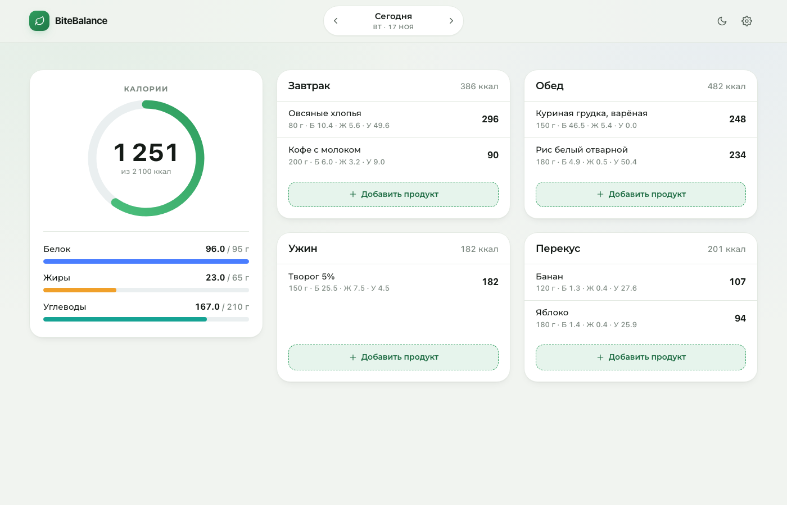
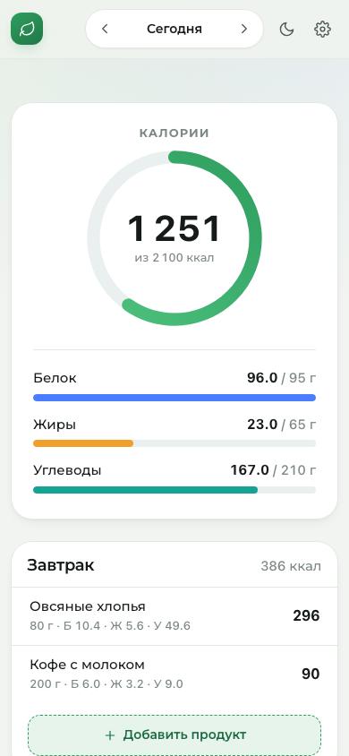

# BiteBalance

Дневник питания: калории, БЖУ, поиск продуктов, сканер штрихкодов и распознавание блюд по фото.
Разворачивается одной командой Docker Compose.



<p align="center">
  
</p>

## Возможности

- **Вход через Яндекс ID** — без логина и пароля: при первом входе аккаунт создаётся сам, сессия живёт в httpOnly-куке, данные дневника разделены по пользователям.
- **Дашборд за день** — карточка «Калории» с кольцом прогресса и БЖУ внутри, рядом — приёмы пищи.
- **Календарь за месяц** — по клику на дату в шапке открывается сетка месяца: дни с записанной едой подсвечиваются зелёным (калорий меньше нормы + 10%) или красным (больше), без записанной еды — без фона. Клик по дню переключает дневник на этот день.
- **Добавление продукта тремя способами**:
  - *Поиск* — по названию или штрихкоду: своя база, затем [Perek](https://perek.us) — основная база российских продуктов и КБЖУ. Open Food Facts остаётся резервом для штрихкодов, которых нет в Perek.
  - *Штрихкод* — сканирование камерой прямо в браузере (ZXing) или ввод цифр вручную.
  - *ИИ* — блюдо определяется по фотографии (съёмка камерой или снимок из галереи) и/или по текстовому описанию до 500 символов. Используется любой OpenAI-совместимый vision-эндпоинт.
- **Умный поиск по каталогу** — своя база с триграммами (находит продукт даже с опечаткой: «гречкв арёная» → «Гречка варёная»), личные продукты и привычные порции. Perek сразу отдаёт КБЖУ. Каждый уникальный запрос обогащается один раз и оседает в своей базе: повторные поиски идут локально, а при недоступности API остаётся всё, что уже скачано.
- **Свои продукты** — редактор с проверкой согласованности калорий и БЖУ, подсказка при переборе.
- **Каталог платформы и личные продукты** — продукты из общего каталога (в том числе из Perek и Open Food Facts) не редактируются: их можно только забрать в свою копию. Править и удалять можно лишь собственные продукты.
- **Фото — прямо в запросе** — снимок ужимается в браузере до 1024 px, кодируется в base64 (data URL) и уходит в теле запроса `POST /api/recognize`. Сервер не хранит его ни на диске, ни в облаке: передал ИИ — и забыл.
- **Бэкап базы** — сервис `maintenance` регулярно складывает дампы (`pg_dump` в gzip) в локальную папку `data/backups` и удаляет старые.
- **История за 60 дней** — записи дневника старше 60 дней удаляются автоматически.
- **Привычные веса** — запоминаем, с каким весом вы добавляли продукт, и предлагаем эти варианты (не больше пяти) рядом со стандартными.
- **Настройки** — дневные нормы калорий и БЖУ, светлая/тёмная/авто тема.
- **Установка на главный экран** — на телефоне внизу главной появляется баннер с пошаговой инструкцией для iPhone и Android: выбираете систему и браузер (Safari, Chrome, Яндекс, Firefox, Opera, другие) и видите, куда нажать. В уже установленном приложении баннер скрыт.
- **Отмена действия** — удаление записи можно откатить из уведомления.
- **Напоминания** — каждый день в 7:00, 13:00, 17:00 и 20:30 МСК приходит push «You can now». Разрешение на уведомления спрашивается при открытии страницы, подписка привязана к аккаунту и работает даже с закрытой вкладкой.

Интерфейс адаптивный: на телефоне открываются bottom-sheet'ы, на десктопе — диалоговые окна.

## Стек

| Слой | Технологии |
|------|------------|
| Фронтенд | React 19, TypeScript, Vite, Bootstrap 5.3, Montserrat |
| Бэкенд | Node.js 20, Fastify 5, TypeScript, PostgreSQL (`pg`) |
| Хранение фото | без отдельного хранилища: base64 (data URL) в теле запроса |
| Каталог продуктов | Perek (основной), Open Food Facts (резерв по штрихкоду), своя база Postgres |
| Инфраструктура | Docker Compose: приложение + PostgreSQL 16 + сервис обслуживания |

Оформление построено на Bootstrap 5.3 (сетка, карточки, формы, модальные окна, list-group),
цветовая тема задаётся CSS-переменными `--bs-*`. Шрифт Montserrat (latin + cyrillic) лежит
в репозитории — контейнер не тянет Google Fonts во время работы.

## Быстрый старт

```bash
git clone https://github.com/ArseniyKvasov/EasyFood.git   # репозиторий пока под старым именем
cd EasyFood
cp .env.example .env          # при необходимости поменяйте пароль БД
docker compose up -d --build
```

Приложение будет доступно на <http://localhost:8080>.

Без приложения Яндекс ID войти не получится: экран входа покажет «Вход через Яндекс
не настроен». Как его создать — в разделе [«Вход через Яндекс ID»](#вход-через-яндекс-id).

Полезные команды:

```bash
docker compose logs -f app     # логи
docker compose ps              # статусы
docker compose down            # остановить
docker compose down -v         # остановить и удалить данные
```

## Вход через Яндекс ID

Логина с паролем больше нет: единственный способ войти — аккаунт Яндекса.
Поток обычный OAuth 2.0 с кодом подтверждения и PKCE, токен и профиль
обрабатываются на сервере, браузер получает только сессионную куку.

1. Откройте <https://oauth.yandex.ru> и создайте приложение: платформа
   **«Веб-сервисы»**.
2. **Redirect URI** — ровно тот адрес, по которому открыт сайт:
   `https://<домен>/api/auth/yandex/callback` (для локальной разработки —
   `http://localhost:3000/api/auth/yandex/callback` или адрес Vite, если
   прокси не настроен).
3. В правах отметьте только **«Доступ к адресу электронной почты»** и
   **«Доступ к логину, имени и фамилии, полу»** — этого хватает: имя, фамилия и
   почта. Отдельного права на имя нет, оно идёт вместе с логином и полом.
   Другой набор прав задаётся через `YANDEX_SCOPE`, пустой `YANDEX_SCOPE` —
   только id и логин.
4. Скопируйте ClientID и Client secret в `.env`:

```bash
YANDEX_CLIENT_ID=...
YANDEX_CLIENT_SECRET=...
YANDEX_REDIRECT_URI=https://food.example.ru/api/auth/yandex/callback
YANDEX_SCOPE=login:info login:email
```

`YANDEX_REDIRECT_URI` можно оставить пустым — тогда адрес собирается из
заголовков запроса (`x-forwarded-proto` и `Host`). Для продакшена лучше задать
явно: значение должно дословно совпадать с Redirect URI в приложении Яндекса.

Аккаунт создаётся при первом входе: пользователь опознаётся по неизменяемому
`id` Яндекса, а имя, фамилия и почта обновляются при каждом входе. Сессия живёт
30 дней, выход — кнопкой «Выйти из аккаунта» в настройках.

Для автотестов адреса API Яндекса можно подменить на свой mock-сервер:
`YANDEX_OAUTH_BASE_URL` (по умолчанию `https://oauth.yandex.ru`) и
`YANDEX_LOGIN_BASE_URL` (по умолчанию `https://login.yandex.ru`).

> Переход с логина и пароля: миграция `007_yandex_auth` удаляет пароли и
> инвалидирует старые сессии. Прежние аккаунты и их записи остаются в базе,
> но `yandex_id` у них пустой, поэтому войти под ними нельзя. Если нужно
> привязать старый дневник к своему Яндексу, выполните один раз:
>
> ```sql
> UPDATE users SET yandex_id = '<id из профиля Яндекса>', login = '<логин>'
>  WHERE id = <id старого аккаунта>;
> ```

## Переменные окружения

| Переменная | По умолчанию | Назначение |
|------------|---------------|------------|
| `APP_PORT` | `8080` | Порт, на котором приложение доступно на хосте |
| `APP_BIND` | `127.0.0.1` | Интерфейс: оставьте `127.0.0.1`, если сайт закрыт nginx'ом |
| `SITE_URL` | пусто | Публичный адрес сайта; нужен `deploy/production.sh` для проверки после выкладки |
| `POSTGRES_USER` / `POSTGRES_PASSWORD` / `POSTGRES_DB` | `bitebalance` | Доступ к базе |
| `CORS_ORIGIN` | пусто | Разрешённые origins через запятую; пусто — CORS выключен |
| `YANDEX_CLIENT_ID` / `YANDEX_CLIENT_SECRET` | пусто | Приложение Яндекс ID; без них войти нельзя |
| `YANDEX_REDIRECT_URI` | пусто | Адрес возврата после входа; пусто — собирается из заголовков запроса |
| `YANDEX_SCOPE` | `login:info login:email` | Права, которые запрашиваем у Яндекс ID |
| `PEREK_API_KEY` | пусто | Ключ [Perek](https://perek.us/developers) — основной базы продуктов и КБЖУ |
| `PEREK_BASE_URL` | `https://perek.us/api/v1/foods` | Адрес API Perek |
| `PEREK_REQUESTS_PER_MINUTE` | `18` | Ограничение частоты запросов к Perek (бесплатный тариф — 20/мин) |
| `PEREK_QUERY_TTL_DAYS` | `30` | Сколько дней не ходить в Perek за уже обогащённым запросом |
| `PEREK_EMPTY_QUERY_TTL_DAYS` | `7` | TTL для запросов, по которым ничего не нашлось |
| `PEREK_SYNC_BATCH` | `3` | Сколько запросов обогащать за один проход обслуживания |
| `PEREK_SYNC_INTERVAL_MINUTES` | `15` | Как часто запускать фоновую синхронизацию каталога |
| `OPEN_FOOD_FACTS_ENABLED` | `true` | Резервный поиск по штрихкоду; отключите, если сервер без интернета |
| `OPENAI_API_KEY` | пусто | Ключ для распознавания блюд по фото (без него функция отключена) |
| `OPENAI_BASE_URL` | `https://api.openai.com/v1` | Любой OpenAI-совместимый endpoint |
| `OPENAI_MODEL` | `gpt-4o-mini` | Модель с поддержкой изображений |
| `OPENAI_REASONING_EFFORT` | пусто | Уровень размышления для reasoning-моделей: `low` \| `minimal` \| `medium` \| `high` \| `xhigh` \| `max` \| `none` |
| `OPENAI_TEMPERATURE` | `0.2` | Температура; пустое значение — поле не отправляется (нужно Claude Haiku 5.5, который принимает только `1`) |
| `OPENAI_MAX_TOKENS` | пусто | Потолок ответа; thinking-токены считаются в тот же лимит |
| `OPENAI_RESPONSE_FORMAT` | `json_object` | `json_object` или `json_schema` (нативные structured outputs) |
| `VAPID_PUBLIC_KEY` / `VAPID_PRIVATE_KEY` | пусто | Ключи Web Push (сгенерировать: `npm run vapid`); без них напоминания выключены |
| `VAPID_SUBJECT` | `mailto:admin@example.com` | Контакт администратора для push-сервисов |
| `BACKUP_DIR` | `data/backups` | Папка для дампов базы (в Docker — том `backups`) |
| `BACKUP_KEEP_DAYS` | `14` | Сколько дней хранить дампы |

## Если оплата не работает

`POST /api/checkout` отвечает `503 BILLING_DISABLED`, когда не хватает настроек. Причина
всегда видна в логе контейнера:

```bash
docker compose logs app-blue | grep billing
# {"level":50,...,"msg":"[billing] ОПЛАТА ВЫКЛЮЧЕНА: TBANK_TERMINAL_KEY не задан; TBANK_PASSWORD не задан. ..."}
```

Проверить то же самое без логов можно под админом:

```bash
curl -s -b "bb_session=<токен админа>" https://<домен>/api/admin/billing/config
# {"ready":false,"issues":["TBANK_TERMINAL_KEY не задан"],"notificationUrl":"..."}
```

Частые причины:

- **Переменные не доехали до контейнера.** `docker-compose.yml` передаёт `TBANK_*` и
  `SITE_URL` из `.env`; после правки compose нужен `docker compose up -d --build`,
  перезапуска контейнера мало.
- **Пустой `SITE_URL`.** Из него собирается адрес вебхука
  (`<SITE_URL>/api/billing/notify`). Можно задать `TBANK_NOTIFICATION_URL` напрямую.
- **`204 «Неверный токен»`.** Подпись не сошлась. В 99% случаев виноват пароль
  терминала: `#` в значении обрезает строку при разборе `.env`, а прилипший в конце
  комментарий попадает в пароль. Пишите так:

  ```ini
  TBANK_TERMINAL_KEY="1795678581017DEMO"
  TBANK_PASSWORD="q216z9R#vRIeAKLD"
  ```

  В логе будет `[billing] Init в Т-Банке не прошёл … Ответ банка: Неверные параметры.
  (Неверный токен. Проверьте пару TerminalKey/SecretKey.)`.
- **Неверный `TBANK_BASE_URL`.** Для боевого терминала `https://securepay.tinkoff.ru/v2`,
  для тестового — тот же адрес, но ключи из тестового кабинета. Ошибка Init пишется в лог
  как `[billing] Init в Т-Банке не прошёл` с кодом и суммой.
- **Контейнер не видит интернет.** Тогда в логе `fetch failed` с кодом причины:
  `ENOTFOUND` — не резолвится DNS, `ECONNREFUSED`/`ETIMEDOUT` — трафик режется фаерволом
  или провайдером, `CERT_*` — подмена сертификата на прокси. Проверка из контейнера:

  ```bash
  docker compose exec app-blue node -e "fetch('https://securepay.tinkoff.ru/v2/Init',{method:'POST',headers:{'Content-Type':'application/json'},body:'{}'}).then(r=>console.log('HTTP',r.status)).catch(e=>console.log('ERR',e.cause?.code||e.message))"
  ```

  `HTTP 4xx` — сеть в порядке, дело в ключах; `ERR ...` — сеть или DNS.

  Если `securepay.tinkoff.ru` из контейнера не резолвится, у Т-Банка есть зеркало —
  задайте `TBANK_BASE_URL=https://securepay.tbank.ru/v2`.

Всё это одной командой проверяет `deploy/check-billing.sh` (работает из любой папки,
ничего не меняет): переменные в контейнере, DNS, HTTPS до банка и health приложения.

```bash
./deploy/check-billing.sh
```

## Локальная разработка

```bash
npm install
docker compose up -d db        # только база
npm run dev                    # API на :3000, фронтенд на :5173
```

Фронтенд в dev-режиме проксирует `/api` на `http://localhost:3000`
(адрес меняется через `API_URL`, см. `web/vite.config.ts`).

Проверка типов и сборка:

```bash
npm run typecheck
npm run build
```

## API

| Метод | Путь | Описание |
|-------|------|----------|
| `GET` | `/api/auth/yandex/start` | Начать вход: редирект на страницу согласия Яндекса |
| `GET` | `/api/auth/yandex/callback` | Возврат из Яндекса: сессия и редирект на главную |
| `POST` | `/api/auth/logout` | Выход (сбрасывает сессию) |
| `GET` | `/api/auth/me` | Текущий пользователь: `{ login, displayName, avatarUrl }` |
| `GET` | `/api/diary?date=YYYY-MM-DD` | Данные за день: нормы, итоги, приёмы пищи |
| `POST` | `/api/entries` | Добавить запись |
| `PATCH` | `/api/entries/:id` | Изменить порцию или название |
| `DELETE` | `/api/entries/:id` | Удалить запись |
| `GET` | `/api/products/search?q=` | Поиск по названию или штрихкоду: своя база, затем Perek |
| `GET` | `/api/products/hints?q=` | Подсказки: своя база и Perek |
| `GET` | `/api/products?q=` | Список продуктов пользователя и каталога |
| `GET` | `/api/products/barcode/:code` | Штрихкод: своя база, Perek, затем Open Food Facts |
| `POST` / `PATCH` / `DELETE` | `/api/products[/:id]` | Свои продукты |
| `GET` / `PUT` | `/api/settings` | Дневные нормы и тема |
| `GET` | `/api/recognize/status` | Включено ли распознавание по фото |
| `POST` | `/api/recognize` | Распознать блюдо по фото (data URL) |
| `GET` | `/api/push/status` | Включены ли напоминания и подписан ли браузер |
| `GET` | `/api/push/public-key` | Публичный ключ VAPID для подписки |
| `POST` / `DELETE` | `/api/push/subscribe` | Подписка браузера на напоминания / отписка |
| `GET` | `/api/health` | Проверка живости |

## Деплой на сервере

Полная инструкция — в [`docs/DEPLOY.md`](docs/DEPLOY.md).
Коротко:

```bash
git clone https://github.com/ArseniyKvasov/EasyFood.git   # репозиторий пока под старым именем
cd EasyFood
cp .env.example .env && nano .env     # пароль БД, SITE_URL, ключи Яндекса
./deploy/production.sh
```

Деплой идёт без простоя: приложение живёт в двух слотах (`app-blue` на
`APP_PORT`, `app-green` на `APP_PORT_GREEN`). Скрипт поднимает свободный слот,
проверяет его healthcheck, переключает nginx на его порт и только потом гасит
старый - открытые запросы не обрываются. Если кандидат не поднялся, трафик
остаётся на старом слоте. `./deploy/production.sh --check` проверяет окружение,
ничего не меняя.

Дальше — nginx как обратный прокси и сертификат Let's Encrypt
(готовые конфиги лежат в [`deploy/nginx`](deploy/nginx)).

Что деплой проверяет сам:

- **Свободное место.** Если диск заполнен больше `MEMORY_GUARD_THRESHOLD_PERCENT`
  (по умолчанию 90%), `deploy/check-memory.sh` делает один проход чистки —
  остановленные контейнеры, старые ротированные логи и дампы сверх окна
  хранения, — и проверяет снова. Не помогло — деплой останавливается до сборки.
  Пробный прогон без удаления: `MEMORY_GUARD_DRY_RUN=1 ./deploy/check-memory.sh`.
- **Российские корневые сертификаты.** Т-Банк подписан корнями Минцифры, которых
  нет в стандартном наборе Node — без них оплата падает с `fetch failed`
  (`SELF_SIGNED_CERT_IN_CHAIN`). Сертификаты из `certs/russian/` (в git) и
  `/etc/bitebalance/russian-ca/` (на сервере) собираются в образ, а после запуска
  кандидата деплой проверяет реальный TLS-хендшейк до банка и не переключает
  трафик, если он не проходит. Подробности — [`certs/README.md`](certs/README.md).

## Безопасность

- Приложение по умолчанию слушает `127.0.0.1` — снаружи доступно только через nginx.
- Паролей нет: вход только через Яндекс ID, OAuth-токен остаётся на сервере и никогда не попадает в браузер.
- Вход защищён параметром `state` (сравнивается constant-time) и PKCE (`S256`); оба секрета живут в httpOnly-куке 10 минут и удаляются после обмена кода.
- Сессия хранится в httpOnly-куке `ef_session` с флагом `Secure` (включается автоматически, если запрос пришёл по HTTPS).
- Все запросы, кроме `/api/health` и `/api/auth/*`, требуют действующей сессии; записи, продукты и настройки привязаны к пользователю.
- Для дополнительной защиты можно закрыть сайт Basic Auth на уровне nginx.

## Лицензия

MIT
