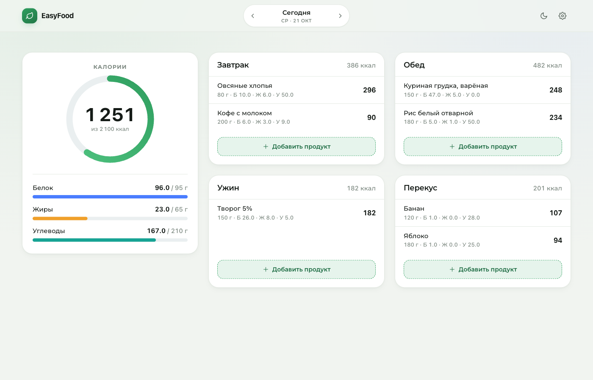
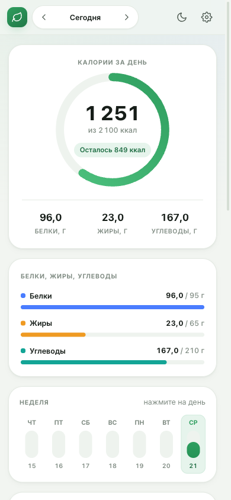

# EasyFood

Дневник питания: калории, БЖУ, поиск продуктов, сканер штрихкодов и распознавание блюд по фото.
Разворачивается одной командой Docker Compose.



<p align="center">
  
</p>

## Возможности

- **Вход и регистрация** по логину и паролю: пароли хранятся в виде scrypt-хэша, сессия — в httpOnly-куке, данные дневника разделены по пользователям.
- **Дашборд за день** — карточка «Калории» с кольцом прогресса и БЖУ внутри, рядом — приёмы пищи.
- **Добавление продукта тремя способами**:
  - *Поиск* — по локальной базе и по [Open Food Facts](https://world.openfoodfacts.org) (с результатами из внешней базы можно сохранить свою версию).
  - *Штрихкод* — сканирование камерой прямо в браузере (ZXing) или ввод цифр вручную.
  - *Фото* — ИИ определяет блюдо и порцию по фотографии (любой OpenAI-совместимый vision-эндпоинт). Можно добавить текстовое описание до 500 символов — оно уточняет состав, когда по фото не видно всех ингредиентов.
- **Свои продукты** — редактор с проверкой согласованности калорий и БЖУ, подсказка при переборе.
- **Привычные веса** — запоминаем, с каким весом вы добавляли продукт, и предлагаем эти варианты (не больше пяти) рядом со стандартными.
- **Настройки** — дневные нормы калорий и БЖУ, светлая/тёмная/авто тема.
- **Отмена действия** — удаление записи можно откатить из уведомления.

Интерфейс адаптивный: на телефоне открываются bottom-sheet'ы, на десктопе — диалоговые окна.

## Стек

| Слой | Технологии |
|------|------------|
| Фронтенд | React 19, TypeScript, Vite, Bootstrap 5.3, Montserrat |
| Бэкенд | Node.js 20, Fastify 5, TypeScript, PostgreSQL (`pg`) |
| Инфраструктура | Docker Compose: один контейнер с приложением + PostgreSQL 16 |

Оформление построено на Bootstrap 5.3 (сетка, карточки, формы, модальные окна, list-group),
цветовая тема задаётся CSS-переменными `--bs-*`. Шрифт Montserrat (latin + cyrillic) лежит
в репозитории — контейнер не тянет Google Fonts во время работы.

## Быстрый старт

```bash
git clone https://github.com/ArseniyKvasov/EasyFood.git
cd EasyFood
cp .env.example .env          # при необходимости поменяйте пароль БД
docker compose up -d --build
```

Приложение будет доступно на <http://localhost:8080>.

Полезные команды:

```bash
docker compose logs -f app     # логи
docker compose ps              # статусы
docker compose down            # остановить
docker compose down -v         # остановить и удалить данные
```

## Переменные окружения

| Переменная | По умолчанию | Назначение |
|------------|---------------|------------|
| `APP_PORT` | `8080` | Порт, на котором приложение доступно на хосте |
| `APP_BIND` | `127.0.0.1` | Интерфейс: оставьте `127.0.0.1`, если сайт закрыт nginx'ом |
| `POSTGRES_USER` / `POSTGRES_PASSWORD` / `POSTGRES_DB` | `easyfood` | Доступ к базе |
| `CORS_ORIGIN` | пусто | Разрешённые origins через запятую; пусто — CORS выключен |
| `OPEN_FOOD_FACTS_ENABLED` | `true` | Отключите, если сервер без интернета |
| `OPENAI_API_KEY` | пусто | Ключ для распознавания блюд по фото (без него функция отключена) |
| `OPENAI_BASE_URL` | `https://api.openai.com/v1` | Любой OpenAI-совместимый endpoint |
| `OPENAI_MODEL` | `gpt-4o-mini` | Модель с поддержкой изображений |
| `OPENAI_REASONING_EFFORT` | пусто | Уровень размышления для reasoning-моделей: `low` \| `minimal` \| `medium` \| `high` \| `xhigh` \| `max` \| `none` |
| `OPENAI_TEMPERATURE` | `0.2` | Температура; пустое значение — поле не отправляется (нужно Claude Haiku 5.5, который принимает только `1`) |
| `OPENAI_MAX_TOKENS` | пусто | Потолок ответа; thinking-токены считаются в тот же лимит |
| `OPENAI_RESPONSE_FORMAT` | `json_object` | `json_object` или `json_schema` (нативные structured outputs) |

## Локальная разработка

```bash
npm install
docker compose up -d db        # только база
npm run dev                    # API на :3000, фронтенд на :5173
```

Фронтенд в dev-режиме проксирует `/api` на `http://localhost:3000`
(адрес меняется через `API_URL`, см. `web/vite.config.ts`).

Проверка типов и сборка:

```bash
npm run typecheck
npm run build
```

## API

| Метод | Путь | Описание |
|-------|------|----------|
| `POST` | `/api/auth/register` | Регистрация: `{ username, password }` |
| `POST` | `/api/auth/login` | Вход: `{ username, password }` |
| `POST` | `/api/auth/logout` | Выход (сбрасывает сессию) |
| `GET` | `/api/auth/me` | Текущий пользователь |
| `GET` | `/api/diary?date=YYYY-MM-DD` | Данные за день: нормы, итоги, приёмы пищи |
| `POST` | `/api/entries` | Добавить запись |
| `PATCH` | `/api/entries/:id` | Изменить порцию или название |
| `DELETE` | `/api/entries/:id` | Удалить запись |
| `GET` | `/api/products?q=` | Поиск по локальной базе |
| `GET` | `/api/products/remote?q=` | Поиск в Open Food Facts |
| `GET` | `/api/products/barcode/:code` | Штрихкод: локальный кэш, затем Open Food Facts |
| `POST` / `PATCH` / `DELETE` | `/api/products[/:id]` | Свои продукты |
| `GET` / `PUT` | `/api/settings` | Дневные нормы и тема |
| `GET` | `/api/recognize/status` | Включено ли распознавание по фото |
| `POST` | `/api/recognize` | Распознать блюдо по фото (data URL) |
| `GET` | `/api/health` | Проверка живости |

## Деплой на сервере

Полная инструкция — в [`docs/DEPLOY.md`](docs/DEPLOY.md).
Коротко:

```bash
git clone https://github.com/ArseniyKvasov/EasyFood.git
cd EasyFood
cp .env.example .env && nano .env     # задайте пароль БД
docker compose up -d --build
```

Дальше — nginx как обратный прокси и сертификат Let's Encrypt
(готовые конфиги лежат в [`deploy/nginx`](deploy/nginx)).

## Безопасность

- Приложение по умолчанию слушает `127.0.0.1` — снаружи доступно только через nginx.
- Пароли хэшируются через `scrypt` с уникальной солью, сравнение — constant-time.
- Сессия хранится в httpOnly-куке `ef_session` с флагом `Secure` (включается автоматически, если запрос пришёл по HTTPS).
- Все запросы, кроме `/api/health` и `/api/auth/*`, требуют действующей сессии; записи, продукты и настройки привязаны к пользователю.
- Для дополнительной защиты можно закрыть сайт Basic Auth на уровне nginx.

## Лицензия

MIT
